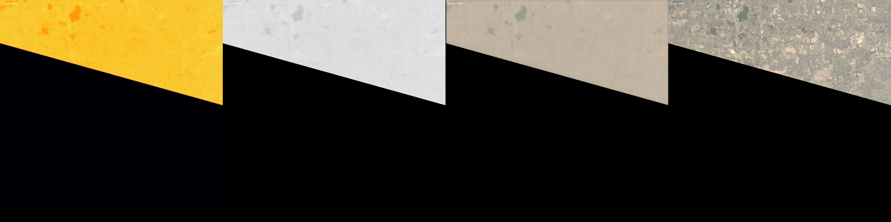

# Infrared Satellite Image Colorization & Enhancement

> Built for the **ISRO Bharatiya Antariksh Hackathon 2026**

A deep learning pipeline that improves low-resolution Thermal Infrared (TIR) satellite imagery in two stages. First, an SRResNet model upscales the image 2x (from 200 m to 100 m). Then a U-Net model colorizes the thermal image into RGB. The goal is to make thermal data from Landsat-9 easier to interpret for disaster management, environmental monitoring, agriculture, and geospatial analysis.

## Features

- **Super-resolution**: an SRResNet with 16 residual blocks upscales 200 m TIR patches to 100 m (2x)
- **Colorization**: a U-Net (`ColorizationUNet`) maps single-channel thermal data to a 3-channel RGB image
- **End-to-end inference pipeline** (`inference/pipeline.py`) that loads a sample, runs both models, and saves the prediction, a false-colour thermal preview, the ground truth, and a side-by-side comparison image
- **Gradio web interface** (`app.py`) with a brightness control, inference timing, hardware info, and a download button for the prediction
- **Dataset generation** from Landsat-9 GeoTIFFs into paired RGB / TIR patches (`datasets/generator.py`)
- **Training and evaluation scripts** with PSNR, SSIM, MAE, and RMSE metrics
- Uses CUDA automatically when a GPU is available, and falls back to the CPU otherwise

## Pipeline

```text
TIR patch (200 m, tir_200m.npy)
        │
        ▼
SRResNet  ──►  2× super-resolved TIR (100 m)
        │
        ▼
ColorizationUNet  ──►  RGB prediction
        │
        ▼
Post-processing (brightness, uint8) ──► outputs/*.png  /  Gradio UI
```

## Results

The pipeline's output for the bundled sample `sample_00187`, from left to right: thermal input (false colour), 100 m TIR, predicted RGB, and ground-truth RGB.



## Repository structure

```text
IR_Hackathon/
├── app.py               # Gradio web app
├── run_inference.py     # Command-line inference on one sample
├── requirements.txt
├── configs/config.py    # Paths and training hyperparameters
├── datasets/            # Landsat-9 patch generator and PyTorch dataset loader
├── inference/           # IRPipeline + visualization helpers
├── models/
│   ├── srresnet/        # Super-resolution model
│   ├── colorizer/       # Colorization U-Net (+ attention gate block)
│   └── unet/            # Experimental U-Net SR model
├── training/            # train_sr.py, train_color.py, evaluate.py, tests
├── utils/               # Metrics, checkpoints, transforms, dataset split
├── sample_input/        # Demo samples sample_00185 – sample_00192
└── outputs/             # Example outputs
```

## Tech stack

Python, PyTorch, OpenCV, NumPy, scikit-image, tifffile, Matplotlib, Gradio

## Installation

```bash
git clone https://github.com/Yafai01/IR_Hackathon.git
cd IR_Hackathon

python -m venv venv
venv\Scripts\activate          # Windows
# source venv/bin/activate     # Linux / macOS

pip install -r requirements.txt
```

## Model checkpoints

Inference needs two trained checkpoints. They are **not included** in the repository (`*.pth` is git-ignored):

```text
checkpoints/best_srresnet.pth
checkpoints/best_colorizer.pth
```

To create them, train the models yourself (see below) or put existing checkpoints in `checkpoints/`.

## Usage

Launch the Gradio app (http://127.0.0.1:7860), then enter a sample folder such as `sample_input/sample_00187`:

```bash
python app.py
```

Or run inference from the command line. Results are written to `outputs/`:

```bash
python run_inference.py
```

Each sample folder contains `tir_200m.npy` (the model input), `tir_100m.npy`, and `rgb.npy` (the ground truth).

## Training

```bash
# 1. Generate patches from a Landsat-9 GeoTIFF (datasets/raw/landsat9_auto.tif)
python datasets/generator.py

# 2. Split into train / val
python utils/split_dataset.py

# 3. Train the models (checkpoints are saved to checkpoints/)
python training/train_sr.py
python training/train_color.py

# 4. Evaluate
python training/evaluate.py
```

You can change the hyperparameters (batch size, epochs, learning rate, number of residual blocks) in `configs/config.py`.

## Dataset

A lightweight demo set (`sample_00185` to `sample_00192`) is included in `sample_input/` for quick testing.

The full dataset is hosted on Kaggle:
https://kaggle.com/datasets/bf114c221642290b97529cef6d882f0276d7dc463b56adba03b0d945a62a2012

Extract it into `datasets/` (processed patches go in `datasets/processed/`). It is not included here because of GitHub storage limits.

## Applications

Disaster management, forest fire monitoring, flood analysis, climate studies, agriculture, environmental monitoring, and urban planning.

## Future work

- Vision Transformer and diffusion-based colorization
- Multi-spectral fusion and Sentinel-2 support
- ONNX / TensorRT export and edge deployment (e.g. Jetson Orin Nano)

## Team

**ISRO Bharatiya Antariksh Hackathon 2026**

- **Project Lead:** Yafai
- **Team Members:** Pohar Jahanavi, Sahil Chavan

## Acknowledgements

- Indian Space Research Organisation (ISRO)
- National Remote Sensing Centre (NRSC)
- Bharatiya Antariksh Hackathon 2026
- PyTorch and OpenCV communities
